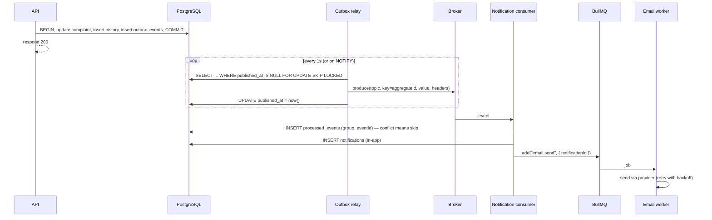

# Event Design

## 1. Principles

1. **PostgreSQL is the source of truth.** Kafka carries facts that already committed.
2. **No dual writes.** A request never writes to Postgres and Kafka separately. It
   writes the business rows and an `outbox_events` row in one transaction; a relay
   publishes later.
3. **At-least-once delivery, idempotent consumers.** Duplicates are expected and harmless.
4. **Kafka distributes events; BullMQ executes work.** A consumer decides _what_ should
   happen and enqueues a job; a BullMQ worker _does_ it with retries and backoff.

|           | Kafka (or memory broker)                 | BullMQ (or inline executor)       |
| --------- | ---------------------------------------- | --------------------------------- |
| Carries   | Domain events ("complaint was assigned") | Commands ("send this email")      |
| Consumers | Many independent groups                  | Exactly one worker type per queue |
| Ordering  | Per complaint (partition key)            | Not guaranteed                    |
| Replay    | Yes, by resetting group offset           | No                                |
| Retry     | Consumer-level, then dead-letter table   | Per job, exponential backoff      |

## 2. Flow



If the relay crashes after producing but before marking the row, the event is produced
again on restart. That is the reason every consumer is idempotent.

## 3. Topics

Three topics, inside the five-topic cap of the Aiven free tier.

| Topic                   | Key             | Events                                                        |
| ----------------------- | --------------- | ------------------------------------------------------------- |
| `civicpulse.complaints` | complaint ID    | all `complaint.*` events                                      |
| `civicpulse.platform`   | organization ID | `organization.*`, `member.*`, `user.*`                        |
| `civicpulse.dlq`        | original key    | events a consumer gave up on (mirror of `dead_letter_events`) |

Two partitions per topic. Keying by complaint ID keeps one complaint's events ordered.

## 4. Envelope

```json
{
  "id": "0b0f6f3e-...", // event ID = outbox row ID; idempotency key
  "type": "complaint.assigned",
  "version": 1,
  "occurredAt": "2026-11-16T09:12:44.120Z",
  "organizationId": "…",
  "aggregateType": "complaint",
  "aggregateId": "…",
  "actorId": "…", // null for system events
  "correlationId": "req_01J…", // request ID that caused the event
  "payload": {}
}
```

Kafka headers: `event-id`, `event-type`, `correlation-id`, and W3C `traceparent` /
`tracestate` so a consumer span continues the trace of the originating HTTP request.

Envelope and payload schemas are Zod definitions in `packages/shared/src/events.ts`.
Producers validate before insert; consumers validate before handling and dead-letter
anything that does not parse. Payloads carry IDs and the fields consumers need — no
passwords, tokens, or signed URLs.

## 5. Event catalogue

| Event                        | Emitted when                               | Notification                                 | Search  | Analytics  |
| ---------------------------- | ------------------------------------------ | -------------------------------------------- | ------- | ---------- |
| `complaint.created`          | Citizen submits                            | Reporter (confirmation), organization admins | index   | invalidate |
| `complaint.updated`          | Title/description/category/priority edited | —                                            | reindex | invalidate |
| `complaint.verified`         | REPORTED → VERIFIED                        | Reporter                                     | reindex | invalidate |
| `complaint.rejected`         | → REJECTED                                 | Reporter                                     | reindex | invalidate |
| `complaint.assigned`         | Assignment created                         | Worker, department manager, reporter         | reindex | invalidate |
| `complaint.work_started`     | → IN_PROGRESS                              | Reporter                                     | reindex | invalidate |
| `complaint.on_hold`          | → ON_HOLD                                  | Reporter                                     | reindex | invalidate |
| `complaint.resolved`         | → RESOLVED                                 | Reporter                                     | reindex | invalidate |
| `complaint.closed`           | → CLOSED                                   | —                                            | reindex | invalidate |
| `complaint.reopened`         | → REOPENED                                 | Admins, previous worker                      | reindex | invalidate |
| `complaint.commented`        | Public comment added                       | Other party                                  | —       | —          |
| `complaint.attachment_added` | Photo uploaded                             | — (enqueues image job)                       | —       | —          |
| `complaint.sla_warning`      | Scheduler: due within threshold            | Worker, manager                              | —       | —          |
| `complaint.sla_breached`     | Scheduler: past due                        | Manager, admins                              | reindex | invalidate |

Password-reset and invitation emails are **not** events. They carry single-use tokens,
so the API hands them straight to the mailer (a BullMQ job from Phase 3) and nothing
secret enters the event stream.

## 6. Consumers

| Group          | Responsibility                                        | Idempotency                                                          |
| -------------- | ----------------------------------------------------- | -------------------------------------------------------------------- |
| `notification` | Create in-app notifications, enqueue emails           | `processed_events` + unique `(user_id, dedupe_key)` on notifications |
| `search-index` | Load current complaint from Postgres, upsert document | `processed_events`; upsert by complaint ID is naturally idempotent   |
| `analytics`    | Invalidate cached analytics for the organization      | `processed_events`; invalidation is naturally idempotent             |

The search consumer indexes the **current database state**, not the event payload, so
out-of-order or replayed events can never write stale data to the index.

## 7. Retries and dead letters

- **Relay:** exponential backoff per row (`attempts`, `last_error`, `next_attempt_at`).
  Rows are never dropped.
- **Consumers:** up to 5 in-process attempts with backoff (200 ms → 3 s). Then the event
  is written to `dead_letter_events` (and produced to `civicpulse.dlq`), the offset is
  committed and processing continues. One poison event must not block a partition.
- **BullMQ jobs:** `attempts: 5`, exponential backoff starting at 5 s. Final failures
  stay in the failed set (bounded) and are recorded on the business row
  (`notifications.email_status = 'FAILED'`).
- **Redrive:** `pnpm --filter @civicpulse/workers dlq:redrive` re-inserts dead letters
  into the outbox.

## 8. Memory broker

With `EVENT_BROKER=memory` the relay hands events directly to the consumers running in
the same process, through the same `EventBroker` interface and the same consumer runner
(idempotency, retries, dead-lettering). Durability comes from the outbox. Limitations,
stated plainly: no replay, no independent consumer scaling, relay and consumers must
share a process. It exists so the product works with zero infrastructure; it is not a
substitute for demonstrating Kafka, which is done against Aiven or an ephemeral Redpanda
container in CI.

## 9. BullMQ queues

| Queue           | Jobs                                                      | Notes                       |
| --------------- | --------------------------------------------------------- | --------------------------- |
| `notifications` | `email.send`                                              | Concurrency 5               |
| `media`         | `image.process` (validate, strip EXIF, resize, thumbnail) | Concurrency 2, memory-bound |

Scheduled work (SLA scan every 5 minutes, retention cleanup daily) uses BullMQ job
schedulers when Redis is available and `setInterval` with a Postgres advisory lock
otherwise, so only one replica runs each tick.
