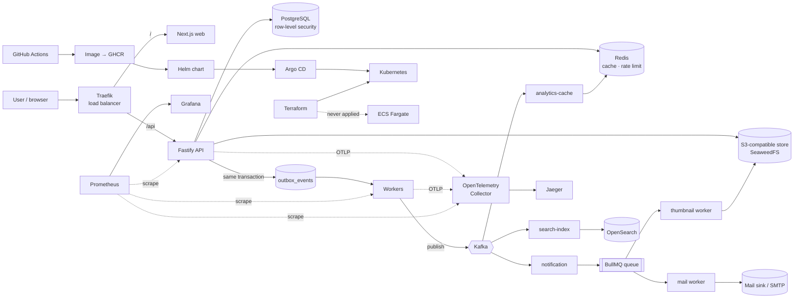

# The Request Journey, box by box

CivicPulse implements every box of the reference diagram with free, open-source software.
This page says where each one lives in the repository, what it does for the product, and how
it is proven. Status labels are defined in [DEVELOPMENT_ROADMAP.md](../DEVELOPMENT_ROADMAP.md).

| Box | What it is here | Where | Proof |
| --- | --------------- | ----- | ----- |
| User | Browser using the Next.js app; anonymous users use public tracking | `apps/web` | browser tests |
| Load balancer | Traefik ingress; routes `/api` to the API and `/` to the web app. `/metrics`, `/healthz`, `/readyz` are not routed. ECS variant: an Application Load Balancer | `infrastructure/terraform/modules/gitops-bootstrap`, `infrastructure/helm/civicpulse/templates/ingress.yaml` | cluster workflow |
| Backend | Fastify API; separate **workers** process for events, queues and schedules | `apps/api`, `apps/workers` | 76 API tests |
| Queue | BullMQ on Redis: `mail` (retried with backoff), `media` (thumbnails), `scheduler` (SLA scan, retention). Falls back to inline execution when Redis is unreachable | `packages/platform/src/queues.ts` | integration tests, failure drill |
| Kafka | Apache Kafka (KRaft). The outbox relay publishes; three consumer groups (`notification`, `search-index`, `analytics-cache`) consume; poison events go to a dead-letter table and topic | `packages/events` | integration tests (real broker), failure drills |
| PostgreSQL | System of record; tenant isolation by row-level security; append-only history | `packages/db` | tenancy tests |
| Redis | Analytics cache (invalidated by events), shared rate-limit counters, BullMQ. Every use fails open | `packages/platform/src/redis.ts`, `cache.ts` | integration tests, failure drill |
| OpenSearch | Full-text, fuzzy, filtered, geo-aware search with highlighting. Results are re-checked against PostgreSQL so a stale index can never leak a complaint | `packages/platform/src/search.ts`, `apps/api/src/modules/search` | 9 integration tests, browser test |
| Amazon S3 | Any S3-compatible store through the AWS SDK. In the cluster: SeaweedFS. The same code runs against AWS S3 or Cloudflare R2 by changing environment variables | `packages/platform/src/storage.ts` | integration tests |
| Prometheus | Scrapes API, workers and the collector | `infrastructure/helm/civicpulse-platform/files/prometheus-k8s.yml` | cluster workflow |
| Grafana | Six provisioned dashboards, generated from `scripts/gen-dashboards.py` | `…/files/grafana/dashboards` | every query evaluated against Prometheus |
| OpenTelemetry | Spans for HTTP, database, outbox publish, Kafka consumers, queued jobs and email; trace context travels through the outbox row, the Kafka headers and the job payload | `packages/platform/src/telemetry.ts` | tracing tests; trace found in Jaeger |
| Jaeger | Trace storage and UI (Jaeger v2) | platform chart | `scripts/jaeger-trace.py` |
| CI/CD | GitHub Actions: CI, image build/push, infrastructure checks, cluster demo | `.github/workflows` | workflow runs |
| Docker / Image | One multi-stage Dockerfile, three non-root images with health checks | `infrastructure/docker/Dockerfile` | built and run |
| Helm | `civicpulse-platform` (data and observability) and `civicpulse` (application) | `infrastructure/helm` | lint + schema validation |
| Argo CD | App-of-apps; automated sync, self-heal, sync waves (platform before app) | `infrastructure/argocd` | cluster workflow |
| Kubernetes | kind in CI, a Codespace or a 16 GB machine | `infrastructure/terraform/environments/kind-cluster` | cluster workflow |
| Terraform | Creates the kind cluster; generates secrets; installs Traefik, Argo CD and the root application | `infrastructure/terraform` | cluster workflow |
| ECS | Fargate services behind an ALB. **Validated, never applied** — it needs an AWS account with a payment method | `infrastructure/terraform/modules/ecs-service` | `terraform validate` only |

## One request through the system

A citizen files a report:

1. Traefik sends `POST /api/v1/complaints` to the API. A server span starts.
2. One PostgreSQL transaction (confined to the citizen's organization by row-level security)
   inserts the complaint, its first history row, an audit record **and an outbox event** that
   remembers the trace.
3. The API answers `201` with the tracking ID. Nothing else has happened yet, and nothing else
   can make the request fail.
4. The relay in the workers process reads the committed outbox row and publishes it to Kafka
   (key = complaint ID, so one complaint's events stay ordered).
5. Three consumer groups receive it. `notification` creates in-app notifications and queues
   emails; `search-index` loads the *current* row and indexes it in OpenSearch;
   `analytics-cache` drops the cached dashboard figures.
6. The mail worker sends each email through SMTP, retrying with backoff on failure.
7. Jaeger shows steps 1–6 as one trace; Prometheus and Grafana show the rates and latencies.

If Kafka, a consumer, Redis, OpenSearch or the mail provider is down at any point, step 2 still
succeeds, and the system catches up when the dependency returns. That is exercised by the
[failure drills](../operations/OBSERVABILITY.md#failure-drills).
