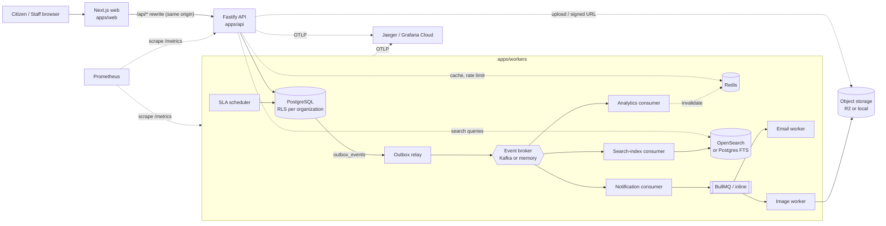
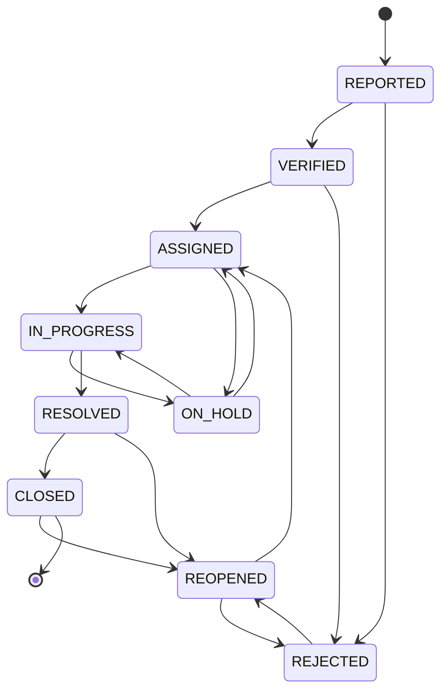

# System Design

## 1. Shape of the system

CivicPulse is a **modular monolith** with one independently runnable worker process.



Why a monolith: one team, one database, one deployable. Module boundaries are enforced
by directory structure and by the rule that modules talk to each other through service
functions, never through each other's tables. Workers are a separate process because
their failure and scaling profile differs from request handling — but they can be
embedded in the API process (`EMBEDDED_WORKERS=true`) for single-container free hosting.

## 2. Repository layout

```
apps/web          Next.js UI (citizen + staff experiences)
apps/api          Fastify REST API, modules under src/modules/<domain>
apps/workers      Outbox relay, event consumers, BullMQ workers, schedulers
packages/shared   Zod contracts, enums, status machine, permission matrix (no I/O)
packages/db       Drizzle schema, SQL migrations, tenant-scoped DB access
packages/platform Config validation, logger, adapters: broker, queue, search, storage, cache, telemetry
```

Dependency direction: `apps → platform → db → shared`. `shared` imports nothing internal.
The web app imports only `shared`.

API modules (`apps/api/src/modules`): `auth`, `users`, `organizations`, `departments`,
`complaints`, `tracking`, `notifications`, `search`, `analytics`, `audit`, `health`.
Each has `routes.ts` (HTTP + schemas) and `service.ts` (business rules + DB access).

## 3. Request path

1. Browser calls `/api/v1/...` on the web origin; Next.js rewrites to the API. Cookies
   stay first-party, so no cross-site cookie configuration or CORS is needed in the
   default deployment.
2. Fastify hooks, in order: request ID → security headers → rate limit → session lookup
   → CSRF check (mutations) → Zod validation → permission guard → handler.
3. The handler calls a service inside `withTenant(organizationId, userId, fn)`, which
   opens a transaction, switches to the restricted database role and sets the tenant
   GUCs. Row-level security then filters every statement.
4. Writes that matter to other parts of the system insert an `outbox_events` row in the
   same transaction.
5. Errors map to one envelope: `{ error: { code, message, details?, requestId } }`.

## 4. Multi-tenancy

- Users are global; membership in an organization carries the role
  (`organization_members.role`). `SUPER_ADMIN` is a platform-level flag on the user.
- A session holds an _active organization_. All tenant-scoped requests are evaluated
  against that organization only.
- Every tenant table has `organization_id NOT NULL` and an RLS policy
  `organization_id = current_setting('app.organization_id')::uuid`.
- The application connects with its normal credentials but each tenant transaction runs
  `SET LOCAL ROLE civicpulse_app` — a `NOLOGIN` role without `BYPASSRLS` — so policies
  apply even if the connection role owns the tables.
- Cross-tenant code paths are explicit and few: authentication, public tracking,
  super-admin operations, and workers. They use `withSystem(fn)` and are reviewed as
  privileged code.

Trade-off: `SET LOCAL ROLE` protects against application bugs (a forgotten `WHERE`),
not against arbitrary SQL execution, because a session could `RESET ROLE`. All queries
are parameterized, and production deployments can additionally connect as a dedicated
login role that is a member of `civicpulse_app` only. See SECURITY.md.

## 5. Complaint lifecycle



The transition table and who may perform each transition live in
`packages/shared/src/complaint-status.ts` and are used by both API and UI. A status
change is one transaction: lock the complaint row, validate transition and actor, update
the complaint, insert `complaint_status_history`, insert `outbox_events`, insert
`audit_logs`. History and audit rows are protected by triggers that reject `UPDATE` and
`DELETE`.

## 6. Adapters and fallbacks

| Port            | Primary driver         | Fallback driver                | Selected by                   |
| --------------- | ---------------------- | ------------------------------ | ----------------------------- |
| Event broker    | `kafka` (kafkajs)      | `memory` (in-process)          | `EVENT_BROKER`                |
| Job queue       | `bullmq`               | `inline` (in-process, retried) | `REDIS_URL` present?          |
| Cache / limiter | Redis                  | In-memory LRU / counter        | `REDIS_URL` present?          |
| Search          | `opensearch`           | `postgres` (tsvector)          | `SEARCH_DRIVER`               |
| Object storage  | `s3` (R2, any S3 API)  | `local` (disk)                 | `STORAGE_DRIVER`              |
| Email           | `smtp` / `resend` HTTP | `log` (structured log)         | `EMAIL_DRIVER`                |
| Telemetry       | OTLP exporter          | disabled                       | `OTEL_EXPORTER_OTLP_ENDPOINT` |

Fallbacks are real implementations of the same interface, covered by the same contract
tests. They are not mocks.

## 7. Failure behaviour

| Failure                       | Behaviour                                                                                        |
| ----------------------------- | ------------------------------------------------------------------------------------------------ |
| Redis down                    | Cache bypassed, rate limiter uses memory, API keeps serving. Jobs wait in outbox/consumer retry. |
| Kafka down                    | Outbox rows accumulate unpublished; relay retries with backoff; nothing is lost.                 |
| Consumer down                 | Kafka retains events (or outbox retains them for the memory broker); processing resumes.         |
| Duplicate event               | `processed_events (consumer_group, event_id)` unique key makes handling idempotent.              |
| Poison event                  | After N attempts the event is written to `dead_letter_events` and the consumer moves on.         |
| Email provider down           | BullMQ retries with exponential backoff; final failure recorded on the notification row.         |
| Search indexing fails         | Consumer retries, then dead-letters; a reindex script rebuilds the index from Postgres.          |
| Image upload/processing fails | Upload is rejected with a clear error; the complaint itself is already saved.                    |
| Database down                 | Readiness probe fails, API returns 503; no partial writes because every write is transactional.  |

## 8. Scaling notes

The API is stateless (sessions in Postgres, cached in Redis) and scales horizontally.
The outbox relay uses `FOR UPDATE SKIP LOCKED`, so multiple worker replicas are safe.
Kafka partitions are keyed by complaint ID, preserving per-complaint ordering. The first
real bottleneck will be Postgres connections — use the Neon pooled endpoint and keep the
pool small (default 10).
