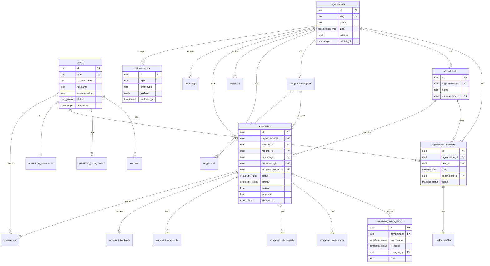

# Database Design

PostgreSQL 15+ (developed against 16). Schema source of truth:
`packages/db/src/schema/`. Migrations: `packages/db/migrations/` (SQL, generated by
drizzle-kit, plus hand-written SQL for RLS, triggers and roles).

## 1. Conventions

- Primary keys: `uuid`, default `gen_random_uuid()`.
- Every table has `created_at timestamptz NOT NULL DEFAULT now()`; mutable tables also
  have `updated_at`.
- Tenant tables carry `organization_id uuid NOT NULL REFERENCES organizations(id)`.
- Soft deletion (`deleted_at`) on users, organizations, departments, complaints,
  comments and attachments. Append-only tables are never deleted.
- Enumerations are PostgreSQL enum types; values mirror `packages/shared`.
- Email uniqueness is case-insensitive through a unique index on `lower(email)`.

## 2. Entity-relationship diagram



## 3. Tables

| Table                      | Purpose                                                            | Key constraints                                                                     |
| -------------------------- | ------------------------------------------------------------------ | ----------------------------------------------------------------------------------- |
| `users`                    | Global identities                                                  | unique `lower(email)`                                                               |
| `sessions`                 | Server-side sessions; stores SHA-256 of the token, never the token | unique `token_hash`; index `(user_id)`, `(expires_at)`                              |
| `password_reset_tokens`    | Single-use reset tokens (hashed)                                   | unique `token_hash`                                                                 |
| `organizations`            | Tenants                                                            | unique `slug`                                                                       |
| `organization_members`     | Membership + role + optional department                            | unique `(organization_id, user_id)`                                                 |
| `invitations`              | Email invitations with hashed token                                | unique `token_hash`; partial unique `(organization_id, lower(email))` where pending |
| `departments`              | Units that resolve complaints                                      | unique `(organization_id, lower(name))`                                             |
| `worker_profiles`          | Field-worker attributes                                            | unique `member_id`                                                                  |
| `complaint_categories`     | Per-organization categories, seeded with nine defaults             | unique `(organization_id, slug)`                                                    |
| `sla_policies`             | Response/resolution targets per category and priority              | unique `(organization_id, category_id, priority)`                                   |
| `complaints`               | The aggregate root                                                 | unique `tracking_id`; check on lat/lng ranges                                       |
| `complaint_assignments`    | Assignment history; one active row per complaint                   | partial unique `(complaint_id)` where status in (`PENDING`,`ACCEPTED`)              |
| `complaint_status_history` | **Immutable** status trail                                         | trigger rejects UPDATE/DELETE                                                       |
| `complaint_attachments`    | Photo metadata; bytes live in object storage                       | index `(complaint_id)`                                                              |
| `complaint_comments`       | Public replies and internal notes (`is_internal`)                  | index `(complaint_id, created_at)`                                                  |
| `complaint_feedback`       | One rating per complaint                                           | unique `complaint_id`; check rating 1–5                                             |
| `notifications`            | In-app notifications + email delivery status                       | unique `(user_id, dedupe_key)`                                                      |
| `notification_preferences` | Per-user channel switches and muted event types                    | primary key `user_id`                                                               |
| `audit_logs`               | **Immutable** record of security-relevant actions                  | trigger rejects UPDATE/DELETE                                                       |
| `outbox_events`            | Transactional outbox                                               | partial index on unpublished rows                                                   |
| `processed_events`         | Consumer idempotency ledger                                        | primary key `(consumer_group, event_id)`                                            |
| `dead_letter_events`       | Events that exhausted retries                                      | index `(consumer_group, created_at)`                                                |

## 4. Important relationships

- **User ↔ organization is many-to-many.** One person can be a citizen in a housing
  society and a field worker at a college. Role is a property of the membership.
- **Complaint denormalizes its current department and worker.** The full history is in
  `complaint_assignments`; the denormalized columns keep list queries to one table and
  are updated in the same transaction as the assignment row.
- **Category → default department** lets verification auto-suggest routing.
- **`sla_due_at` is computed once at verification** from the matching `sla_policies` row
  (category-specific first, then the organization default with `category_id IS NULL`),
  so later policy edits do not silently move deadlines of existing complaints.

## 5. Indexes

| Index                                                              | Serves                                                  |
| ------------------------------------------------------------------ | ------------------------------------------------------- |
| `complaints (organization_id, status, created_at DESC)`            | Staff queue, default list ordering                      |
| `complaints (organization_id, reporter_id, created_at DESC)`       | "My complaints"                                         |
| `complaints (organization_id, department_id, status)`              | Department manager queue, department analytics          |
| `complaints (organization_id, assigned_worker_id, status)`         | Field worker queue                                      |
| `complaints (organization_id, category_id)`                        | Category distribution                                   |
| `complaints (organization_id, sla_due_at)` where status is open    | Overdue scan by the SLA scheduler                       |
| `complaints USING gin (search_vector)`                             | Fallback full-text search (generated `tsvector` column) |
| `complaint_status_history (complaint_id, created_at)`              | Timeline                                                |
| `notifications (user_id, created_at DESC)` where `read_at IS NULL` | Unread badge                                            |
| `outbox_events (created_at)` where `published_at IS NULL`          | Relay polling stays O(pending)                          |
| `audit_logs (organization_id, created_at DESC)`                    | Audit viewer                                            |

## 6. Row-level security

Enabled on every tenant table, with policies that apply to the restricted role:

```sql
ALTER TABLE complaints ENABLE ROW LEVEL SECURITY;
CREATE POLICY tenant_isolation ON complaints
  FOR ALL TO civicpulse_app
  USING (organization_id = nullif(current_setting('app.organization_id', true), '')::uuid)
  WITH CHECK (organization_id = nullif(current_setting('app.organization_id', true), '')::uuid);
```

RLS is deliberately **not** `FORCE`d: the table owner must remain able to run the
privileged paths (authentication, public tracking, workers). Tenant code never runs as
the owner — `withTenant` switches role before the first statement.

`current_setting(..., true)` returns NULL when unset, so a transaction that forgot to
set the tenant sees **zero rows** and cannot insert — it fails closed.

`civicpulse_app` is `NOLOGIN NOBYPASSRLS` with DML grants only (and only `SELECT`/`INSERT`
on the append-only tables). Tenant transactions
enter it with `SET LOCAL ROLE`. `organizations` is filtered by `id`. `users` has a column-level grant that excludes
`password_hash` and a policy limiting visibility to the acting user and members of the
active organization. `sessions` and `password_reset_tokens` are not granted at all.

## 7. Migrations

- `pnpm db:generate` — drizzle-kit diffs the schema and writes a numbered SQL file.
- `pnpm db:migrate` — applies pending files in order inside a transaction each, tracked
  in `drizzle.__drizzle_migrations`.
- RLS, triggers and roles are hand-written SQL migrations, because drizzle-kit does not
  diff them reliably. They are idempotent.
- Migrations run with `DATABASE_MIGRATION_URL` when set (owner role, direct connection),
  otherwise `DATABASE_URL`.

## 8. Retention and deletion

| Data                                          | Retention                                |
| --------------------------------------------- | ---------------------------------------- |
| Sessions                                      | Deleted 30 days after expiry/revocation  |
| Password reset tokens, expired invitations    | Deleted 7 days after expiry              |
| Published outbox rows, processed-event ledger | Deleted after 14 days                    |
| Notifications                                 | Deleted after 180 days                   |
| Audit logs                                    | Kept 2 years (configurable)              |
| Complaints                                    | Kept; they are the organization's record |

**Account deletion** anonymizes rather than cascades: the user row keeps its ID, email
becomes `deleted+<uuid>@invalid`, name becomes "Deleted user", password hash and phone
are cleared, sessions are revoked, memberships deactivated. Complaints remain attributed
to the anonymized ID so the organization's history stays intact.
