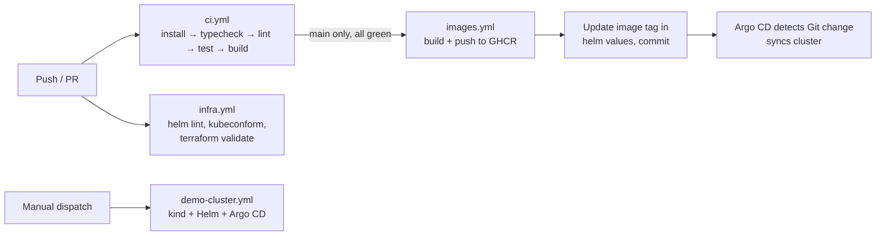

# Infrastructure Design

> **Superseded in part (2026-11-18).** This document was written when managed free tiers (Neon, Upstash, Aiven, R2) were the plan. The architecture now self-hosts every component in Kubernetes; see [decision 0001](../decisions/0001-zero-cost-full-stack.md) and the [request journey](../architecture/REQUEST_JOURNEY.md). Where this text and those disagree, they win. Free-tier figures below were verified in November 2026 and are kept as the optional managed back ends.

## 1. Environments

| Environment          | Where                              | What runs                                                                                                                                                  |
| -------------------- | ---------------------------------- | ---------------------------------------------------------------------------------------------------------------------------------------------------------- |
| Development          | Laptop + free managed services     | `pnpm dev` (web + API with embedded workers). Postgres on Neon or a local install. Everything else optional.                                               |
| CI                   | GitHub Actions runners             | Typecheck, lint, unit + integration tests (Postgres and Redis service containers), builds, image builds, chart validation.                                 |
| Ephemeral demo       | GitHub Actions `workflow_dispatch` | `kind` cluster: Helm install, Argo CD sync and rollback demonstration, Prometheus/Grafana/Jaeger, Redpanda. Destroyed when the job ends.                   |
| Zero-cost hosted     | Free tiers                         | Web and API on free application hosting; data on Neon/Upstash/Aiven. Documented in the zero-cost guide (Phase 5), with providers re-verified at that time. |
| Reference production | Kubernetes or ECS                  | Configured, not deployed. No paid resources are created by this project.                                                                                   |

## 2. Containers

Three images from one multi-stage Dockerfile pattern (`infrastructure/docker/`):

| Image                | Base             | Notes                                                                                    |
| -------------------- | ---------------- | ---------------------------------------------------------------------------------------- |
| `civicpulse-api`     | `node:22-alpine` | `pnpm deploy`-pruned production dependencies, non-root user, `HEALTHCHECK` on `/healthz` |
| `civicpulse-workers` | `node:22-alpine` | Same pattern; health endpoint on a side port                                             |
| `civicpulse-web`     | `node:22-alpine` | Next.js `output: "standalone"`, non-root                                                 |

Images are built by GitHub Actions and pushed to GHCR, tagged with the commit SHA and
`latest` on the default branch. Docker is not required on the laptop.

## 3. CI/CD

Deployment is gated: the image workflow `needs` the CI job; nothing is published or
deployed when a mandatory check fails. Deployment is pull-based (GitOps): CI never holds
cluster credentials.

## 4. Kubernetes

One Helm chart (`infrastructure/helm/civicpulse`) is the source of truth; plain manifests
in `infrastructure/kubernetes/` are rendered from it for readers who do not use Helm.

| Workload | Kind                        | Probes                                   | Scaling                                                |
| -------- | --------------------------- | ---------------------------------------- | ------------------------------------------------------ |
| api      | Deployment + Service        | liveness `/healthz`, readiness `/readyz` | HPA on CPU, 2–6 replicas                               |
| web      | Deployment + Service        | `/`                                      | HPA, 2–4 replicas                                      |
| workers  | Deployment                  | side-port `/healthz`                     | 1–3 replicas (safe: `SKIP LOCKED` relay, Kafka groups) |
| migrate  | Job (Helm pre-upgrade hook) | —                                        | Runs `db:migrate` before new pods start                |

Also: ConfigMap for non-secret settings, `existingSecret` reference for secrets, Ingress
with path routing (`/api` → api, `/` → web), resource requests/limits, PodDisruptionBudget,
security context (non-root, read-only root filesystem, dropped capabilities), and
`ServiceMonitor` behind a values flag.

Values files: `values.yaml` (defaults), `values-dev.yaml`, `values-prod.yaml`,
`values-kind.yaml` (ephemeral demo).

## 5. Argo CD

`infrastructure/argocd/` contains an `AppProject` and an `Application` pointing at the
chart path in this repository, with automated sync, `prune`, `selfHeal`, and retry
policy. Rollback is demonstrated two ways: `git revert` (the GitOps way) and
`argocd app rollback`. The demo workflow installs Argo CD on `kind`, applies the
Application, waits for `Healthy/Synced`, and prints the status.

## 6. Terraform

`infrastructure/terraform/` holds reusable modules and two root configurations:

| Path                    | Purpose                                | Cost                                                     |
| ----------------------- | -------------------------------------- | -------------------------------------------------------- |
| `modules/neon-database` | Neon project, database, roles          | Free tier                                                |
| `modules/upstash-redis` | Upstash database                       | Free tier                                                |
| `modules/r2-bucket`     | Cloudflare R2 bucket + CORS            | Free tier (may require payment method — optional module) |
| `modules/ecs-service`   | Fargate service, ALB target, log group | **Paid — reference only**                                |
| `environments/free`     | Wires the free-tier modules            | Free                                                     |
| `environments/aws-ecs`  | ECS alternative architecture           | **Paid — never applied by this project**                 |

State: local by default for the free environment (git-ignored); documented options for
remote state. Provider tokens come from environment variables. CI runs `terraform fmt
-check` and `terraform validate` only — **never `apply`**. Applying anything is a manual,
explicit user action; the ECS root additionally requires `-var confirm_paid_resources=true`.

## 7. Observability stack

| Signal     | In the app                                                      | Local/ephemeral backend    | Free hosted backend                   |
| ---------- | --------------------------------------------------------------- | -------------------------- | ------------------------------------- |
| Metrics    | `prom-client` at `/metrics` (HTTP, DB, queue, consumer, outbox) | Prometheus in demo cluster | Grafana Cloud (remote write or Alloy) |
| Traces     | OpenTelemetry SDK, OTLP/HTTP exporter                           | Jaeger all-in-one          | Grafana Cloud Tempo                   |
| Logs       | pino JSON to stdout with `trace_id`                             | `kubectl logs`             | Grafana Cloud Loki                    |
| Dashboards | JSON in `monitoring/grafana/dashboards/`                        | Provisioned Grafana        | Import into Grafana Cloud             |

The OpenTelemetry Collector config in `monitoring/otel/` receives OTLP and fans out to
Jaeger and Prometheus, so the application only ever knows one endpoint.

## 8. ECS alternative

Documented architecture: ALB → two Fargate services (web, api) + one worker service,
images from GHCR, secrets from SSM Parameter Store, logs to CloudWatch, the same managed
data services. Terraform for it validates but is not applied. Fargate, ALB and NAT have
no free tier adequate for this workload; the document states expected monthly cost
ranges so the trade-off is visible.

## 9. Backup and recovery

- Neon: point-in-time restore within the free-tier history window, plus branch-based
  restore testing.
- Portable backup: `scripts/backup.sh` runs `pg_dump --format=custom`; a scheduled
  GitHub Actions workflow can store encrypted dumps as artifacts.
- Search index and caches are derived data: rebuilt with the reindex script.
- Object storage: R2 has no free versioning guarantees; originals are write-once keys,
  never overwritten.
